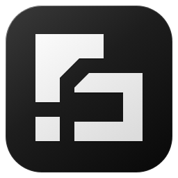

<div align="center">



# Dougong Desktop

**Dougong SDK 的参考桌面宿主**

<sub>Avalonia + TKCode.Arc 构建的原生桌面客户端</sub>

<br>

[](https://github.com/zhanghaojie513/Dougong)
[](https://dotnet.microsoft.com/)
[](https://avaloniaui.net/)
[](https://github.com/AIDotNet/TKCode.Arc)
[](https://github.com/zhanghaojie513/DougongDesktop/actions/workflows/build.yml)
[](LICENSE)

</div>

---

> [!WARNING]
> **早期开发中。** SDK 处于 `0.1.x-alpha`，TKCode.Arc 处于 `0.3.2-preview`。
> 签名与行为可能在任意提交中变更，不适合作为依赖。

> [!NOTE]
> 这个项目不只是"做一个能用的客户端"。
> 它是 Dougong SDK 的**示范宿主**——用来证明 SDK 的三个承诺真的成立。

---

## 它要证明什么

<table>
<tr>
<td width="33%" valign="top">

### 可内嵌

Agent 运行时能被真实宿主内嵌，
而不只是跑在 CLI 里。

`AgentHost` 直接引用 SDK，
创建内核、加载插件、跑会话。

</td>
<td width="33%" valign="top">

### 可扩展

两套插件契约，各自演进：

**agent 插件** 提供能力
（工具 / Skill / MCP）

**UI 插件** 提供形态
（换皮肤 / 换布局 / 加陪伴）

</td>
<td width="33%" valign="top">

### 可替换

UI 与 SDK 彻底解耦。

换掉 agent 框架只需重写
`Framework` 一层（4 个文件、约 800 行），
**UI 一行不改**。

</td>
</tr>
</table>

---

## 架构

```text
┌───────────────────────────────────────────────────────┐
│  DougongDesktop.App            Avalonia + TKCode.Arc  │
│  UI 进程 · JIT · 装 UI 插件                            │
└────────────────────────┬──────────────────────────────┘
                         │ 只依赖 DougongDesktop.Ipc
┌────────────────────────▼──────────────────────────────┐
│  DougongDesktop.Ipc            纯契约 · NDJSON over TCP│
└────────────────────────▲──────────────────────────────┘
                         │ 只依赖 DougongDesktop.Ipc
┌────────────────────────┴──────────────────────────────┐
│  DougongDesktop.Framework      唯一知道 SDK 的地方     │
└────────────────────────▲──────────────────────────────┘
                         │ 内嵌 Dougong.* NuGet 包
┌────────────────────────┴──────────────────────────────┐
│  DougongDesktop.AgentHost      引擎进程 · JIT · 装 agent 插件 │
└───────────────────────────────────────────────────────┘
```

### 三条硬边界（由测试执行，不是文档约定）

| 规则 | 违反后果 |
|---|---|
| `App` **不得引用任何 `Dougong.*`** | 换框架时 UI 也要改——那是重写产品，不是适配 |
| `Ipc` / `Framework` / `AgentHost` 不得引用 Avalonia / Arc | UI 技术栈渗进框架层，两套插件体系混淆 |
| `Ipc` 只能依赖 BCL | UI 与框架不再只共享消息类型 |

守卫在 `tests/DougongDesktop.Architecture.Checks`。**每条都有反证**——故意破坏架构时它必须变红。
一条从没红过的检查等于没有检查。

### 为什么两个进程都是 JIT

`AgentHost` 用 `AssemblyLoadContext` 动态加载 agent 插件，`App` 要加载 UI 插件——
两者都与 NativeAOT 不兼容。

**代价**：安装包变大、启动变慢。**换来的**：插件可替换。这是刻意的取舍。

---

## 当前进度

| 阶段 | 内容 | 状态 |
|:---:|---|:---:|
| **P0** | 装配正确性回归（六项判据） | ✅ |
| **P1** | 架构守卫（三条断言 + 三条反证） | ✅ |
| **P2** | Arc 组件可用性验证 | ✅ |
| **P3** | 应用外壳：slot 框架 + 三栏 + 侧边栏 + 状态胶囊 + Cmd+K + 序号重同步 | ✅ |
| **P4** | 消息流：七种条目 + 工具输出折叠 + 虚拟化（1000 条 → 18 容器） | ✅ |
| **P5** | 工具与计划：参数键值对 / 两段耗时 / 推理流 / SDK 计划工具 | ✅ |
| **P6** | 审批闭环：内联卡片 + 四档决策 + 待决锁 + 过期处理 + 输入区 | ✅ |
| **P7** | 右栏 dock：文件 / 改动 / 计划（可用的三个），上下文与终端如实标注未实现 | ✅ |
| P7.5–P10 | 插件管理 / 持久化 / 设置 / 验收 | ⬜ |

**已能跑通**：AgentHost 启动 → IPC 连接 → 真实 provider 对话 → 流式回复。

**49 条行为检查全部通过，每条都能用 `--break=<名字>` 反证变红。**
从没红过的检查等于没有检查——所以 `scripts/all-checks.sh` 跑的不只是正向。

<details>
<summary><b>P2 验证了什么</b>（点击展开）</summary>

用控件树 dump 确认每个组件真的实例化并参与布局（尺寸非零 + 实例数）：

| 组件 | 实测尺寸 |
|---|---|
| `Button` ×8 / `Card` ×5 / `Badge` ×3 / `Switch` ×1 | 全部非零 |
| `Markdown` | 617×180，流式长度 `10→14→20→26` 单调递增 |
| `Table` | 617×280 |
| `AgentStatus` | 96×40（紧凑胶囊形态） |
| `ToolCall` | 617×50.7 |
| `AgentPlan` | 560×140 |
| `ContextWindow` | 617×200 |
| 深浅主题切换 | `IsDark` False→True |

**结论**：Arc 三个 preview 包真的能用。
</details>

---

## 快速开始

### 前置

- .NET SDK **10.0.402**（见 `global.json`）
- Windows / macOS / Linux

### 构建与自检

```bash
dotnet build DougongDesktop.slnx -c Release

# 全量自检：构建 + 架构守卫（正向 + 反证）
bash scripts/all-checks.sh
```

不联网、不需要 provider。

### 跑起来

```bash
dotnet run --project src/DougongDesktop.App
```

界面启动时会自动拉起引擎（`AgentHost`）——引擎把端口写进
`~/.dougong-desktop/endpoint.json`，UI 读它来连接。

> [!IMPORTANT]
> **首次使用需要在设置里添加提供商。** 桌面端不内置任何 provider 目录，
> 也**不做账户登录**——你需要自己填服务地址、模型名和密钥，跟其他 AI 客户端一样。
>
> 不做登录是**刻意的**：没有后端账号体系，加一道登录只会给首启添无必要的门槛。
> 这个项目的定位是示范 SDK，不是运营服务。
>
> 还没做设置界面的阶段（P0–P2），只能靠环境变量驱动引擎，
> 见下方「开发期配置」。

#### 提供商配置（P9 完成后）

设置 → 提供商 → 添加：

| 字段 | 说明 |
|---|---|
| 名称 | 随便取，用于区分多条配置 |
| 服务地址 | 如 `https://api.minimaxi.com/anthropic` |
| 协议 | `openai` / `anthropic` / `responses`——**必须与端点匹配** |
| 模型 | 如 `MiniMax-M3.1-Flash` |
| 密钥 | 存入系统钥匙串，**不写配置文件** |
| 最大上下文 | 按模型名推断预填，可改 |
| 最大输出 | 默认 4096 |

> [!TIP]
> **协议必须显式匹配端点。** 地址含 `/anthropic` 但协议写 `openai` 会 404，
> 而报错信息不会指向这个原因。

<details>
<summary><b>开发期配置（P0–P2，仅环境变量）</b></summary>

设置界面还没做，所以现在只能这样跑：

```bash
# 终端 1：引擎
export DOUGONG_PROVIDER_BASE=https://api.minimaxi.com/anthropic
export DOUGONG_PROVIDER_MODEL=<模型名>
export DOUGONG_PROVIDER_PROTOCOL=anthropic
export DOUGONG_PROVIDER_KEY=<你的 key>
dotnet run --project src/DougongDesktop.AgentHost

# 终端 2：界面
dotnet run --project src/DougongDesktop.App
```

**这只是临时形态，不是产品设计。** P9 会把这一层换成"环境变量优先，
否则问凭据管理器"，让用户能在界面里配。

| 变量 | 必需 | 说明 |
|---|:---:|---|
| `DOUGONG_PROVIDER_BASE` | ✅ | 服务地址 |
| `DOUGONG_PROVIDER_MODEL` | ✅ | 模型名 |
| `DOUGONG_PROVIDER_KEY` | ✅ | 密钥（P9 后可存系统钥匙串） |
| `DOUGONG_PROVIDER_PROTOCOL` | | `openai`（默认）/ `anthropic` / `responses` |
| `DOUGONG_ANTHROPIC_PATH` | | Anthropic 路径覆盖，默认 `/v1/messages` |
| `DOUGONG_CONTEXT_WINDOW` | | 模型窗口；不设则按模型名推断 |
| `DOUGONG_MAX_OUTPUT` | | 单次输出上限，默认 4096 |
| `DOUGONG_SESSION_DIR` | | 会话目录，默认 `~/.dougong-desktop/sessions` |
| `DOUGONG_WORKSPACE` | | 工作区目录 |

</details>


## 目录结构

```text
src/
├── DougongDesktop.Ipc/          IPC 契约（消息类型 + NDJSON），零外部依赖
├── DougongDesktop.Framework/    SDK 投影层 —— 唯一知道 Dougong.* 的地方
├── DougongDesktop.AgentHost/    引擎进程（可执行）
└── DougongDesktop.App/          UI 进程（Avalonia + TKCode.Arc）

tests/
└── DougongDesktop.Architecture.Checks/   架构守卫（三条断言 + 反证开关）

scripts/
└── all-checks.sh                全量自检（CI 与本地共用这一份）

design-demos/                    设计探索稿（非产品代码）
prototype/                       交互原型（同上）
```

---

## 关键设计决定

| 决定 | 理由 |
|---|---|
| **`App` 禁止引用 `Dougong.*`** | UI 只认 IPC 契约；换框架时 UI 不动 |
| **两进程都 JIT** | 为支持插件加载，放弃 AOT 的体积与启动优势 |
| **IPC 用 NDJSON over TCP** | 跨平台一套代码，能手工 `nc` 调试 |
| **消息流自建 `ItemsControl`** | Arc 的 `ChatThread` 不支持自定义条目模板，无法内嵌工具卡片 |
| **验收标准是"行为等价"** | 截图看不出事件顺序错、状态机错、重放不一致 |

---

## 与 SDK 的关系

- 通过 **nuget.org** 消费 `Dougong.*` 包，**不做跨仓 `ProjectReference`**
- 包版本写死在 `Directory.Packages.props`，升级时只改一行
- SDK 的架构测试扫不到本仓库，所以本仓库有自己的守卫

---

<div align="center">

**MIT License**

<sub>[Dougong SDK](https://github.com/zhanghaojie513/Dougong) · [TKCode.Arc](https://github.com/AIDotNet/TKCode.Arc) · [Avalonia](https://avaloniaui.net/)</sub>

</div>
